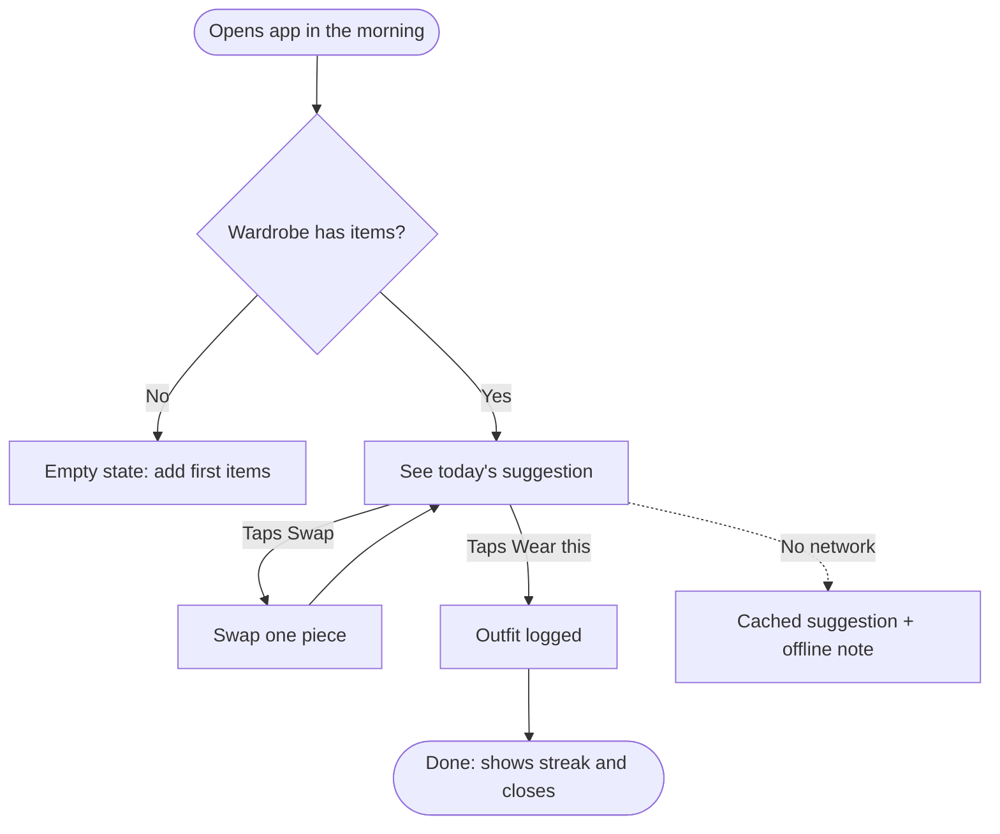

# Flow notation

The rendered visual comes from `scripts/render_flow.py` (see SKILL.md). Mermaid is the portable text format: the script writes a `.mmd` file you can paste into docs, FigJam or mermaid.live. The conventions below apply whether you write Mermaid by hand or through the script's spec.

## Conventions

- Rectangles for screens or steps: `A[Pick occasion]`
- Diamonds for decisions: `B{Has items?}`
- Rounded for start and end: `S([Opens app from widget])`
- Dashed lines for unhappy or optional paths: `-.->`
- Label edges with the user's action or the condition: `-->|Taps Save|`
- Keep one diagram under ~15 nodes. Split larger flows into sub-flows and link them.

## Example

## Step list format

Pair every diagram with a numbered list:

1. **See today's suggestion**: show one outfit based on weather and calendar. Primary action: Wear this.
2. **Swap one piece**: replace a single item without restarting. Primary action: Use this.
3. ...
